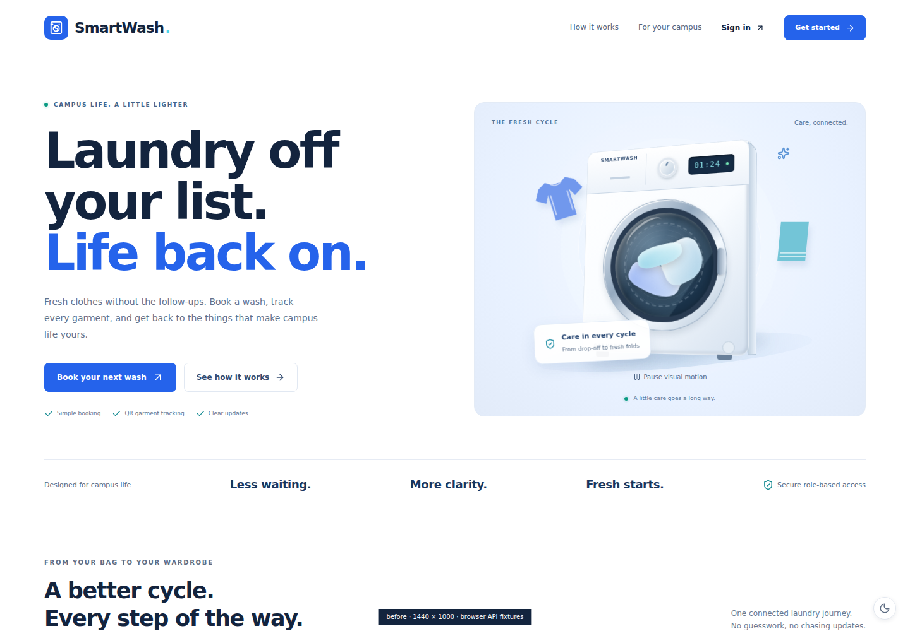
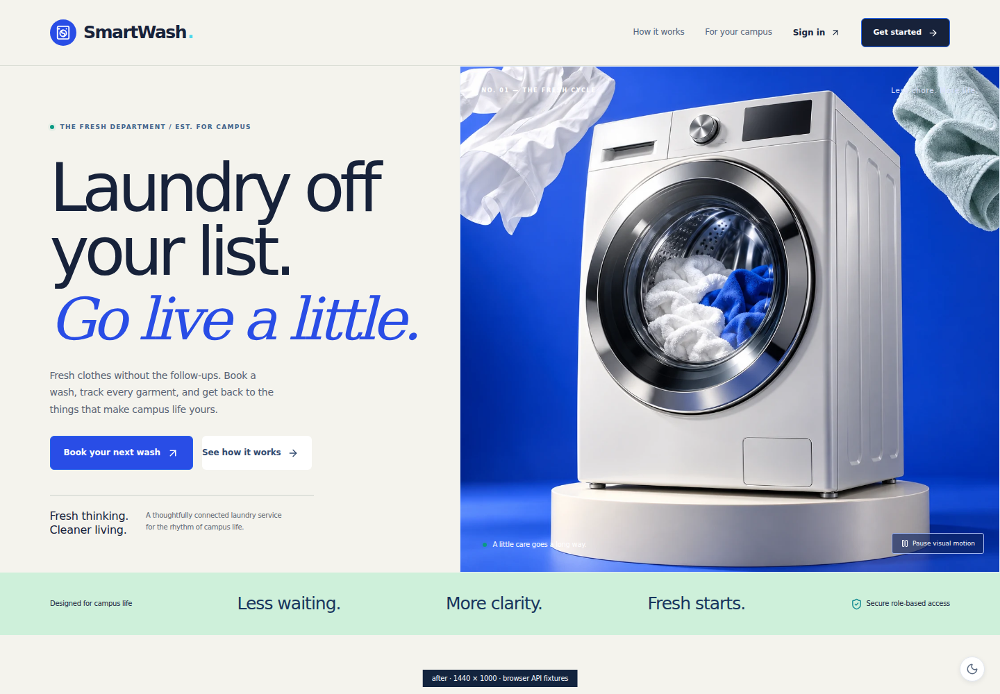
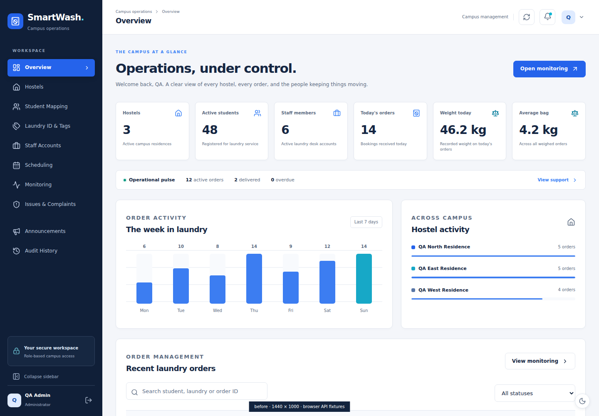
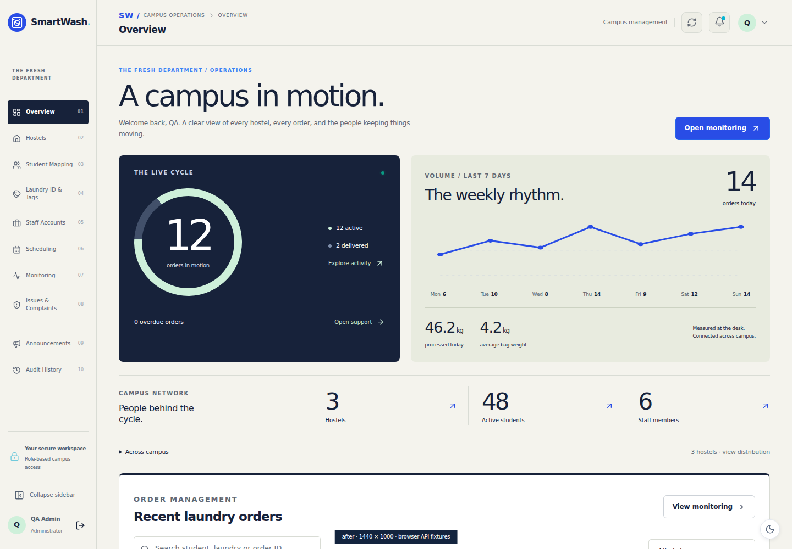
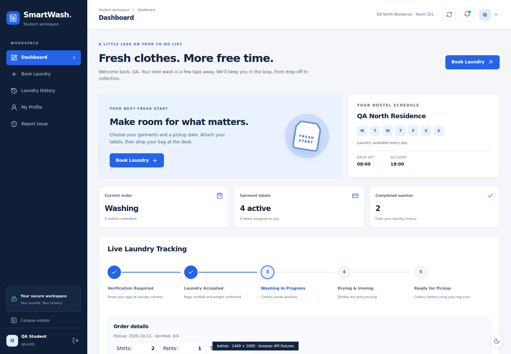
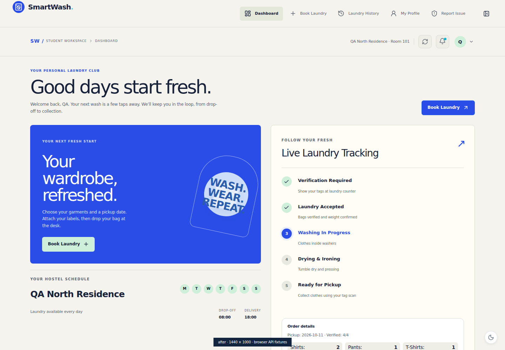
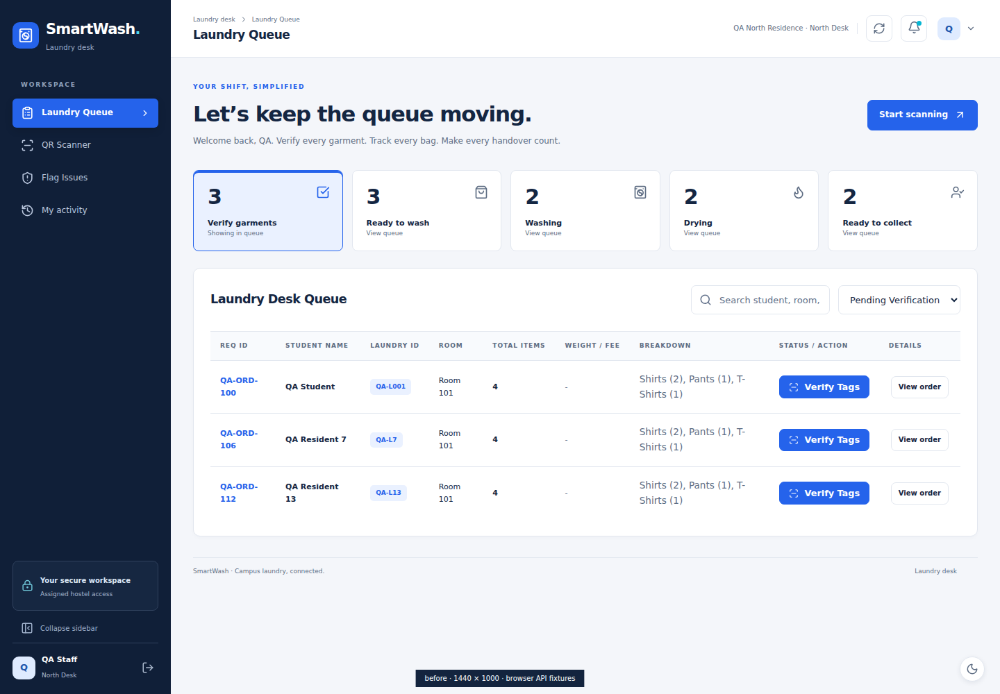
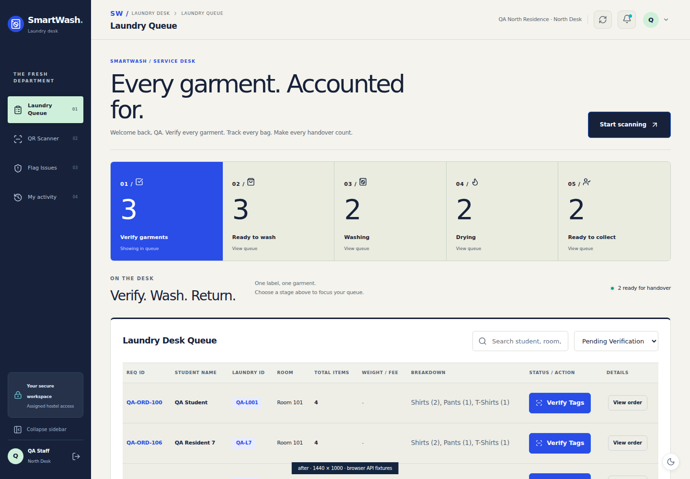

# SmartWash — The Fresh Department

Implemented directly in `Smart_Wash-main/frontend`, October 11, 2026. This report supersedes the prior redesign report.

## Actual route inspection and prior limitation

`frontend/src/App.jsx` renders `AdminPortal`, `StudentPortal`, or `StaffPortal` after the existing authenticated-user and role checks. `/admin`, `/student`, and `/staff` use those components. The public root uses `AuthScreen` → `LandingPage`. No duplicate application or alternate routing was added.

The previous code really was connected to these routes, but its composition remained conventional: the same 246px navy sidebar across all roles, small uniform headings, six Admin metric cards, ordinary chart panels, and a relatively small CSS washer. Its shared visual treatment made the portals feel interchangeable. `main.jsx` loaded `index.css` and then `premium.css`; several highly specific legacy rules also overrode new colors and layout values. The new imported `editorial.css` deliberately resolves those conflicts. The primary dashboard JSX, shared navigation markup, hero component and garment-picker markup have also changed.

## Visible transformation

- **Landing:** edge-to-edge split composition, oversized typography with a serif italic accent, a full-height studio washing-machine focal point, floating garments, mint promise strip, numbered service journey, and an editorial campus section. Gentle motion and pointer parallax are optional; pause/resume, reduced motion, and a CSS washer asset-failure fallback remain available.
- **Admin:** warm compact navigation rail, large typographic welcome, an active/delivered cycle ring, a labelled seven-day line chart, integrated weight figures, a campus network ledger, expandable hostel distribution, and a refined searchable order workspace. The six-card KPI row has been removed. All figures derive from existing API responses; no production sample statistics were added.
- **Student:** horizontal desktop navigation, a cobalt booking feature with mint CTA, an adjacent cream tracking receipt with a vertical progress journey, hostel schedule below the booking feature, a personal history journal, and garment selection tiles in the booking form. Existing schedule eligibility, weight/rate information, validation, fees and actions remain connected.
- **Staff:** compact service navigation, large desk masthead, a numbered workflow control strip, stage totals tied to the queue filters, ready-for-handover context, and a refined queue with prominent verification actions. Existing scanner, manual tag entry, garment count, measured weight, fee calculation and status handlers are retained.

## Exact source files changed in this iteration

All paths below are relative to `Smart_Wash-main/`.

| File | Change |
| --- | --- |
| `frontend/src/main.jsx` | Imports the active editorial stylesheet after the existing base styles. |
| `frontend/src/editorial.css` (new) | Warm paper/midnight/cobalt/mint system, distinct role layouts, editorial hierarchy, chart/table/form presentation, responsive rules, dark theme corrections, motion preferences and legacy cascade corrections. |
| `frontend/src/components/LandingPage.jsx` | New headline composition, editorial brand labels, supporting edition block and prominent studio scene. Existing sign-in/registration callbacks retained. |
| `frontend/src/components/LaundryScene.jsx` | Optimized studio image, descriptive alt text, image-failure CSS fallback, optional pointer parallax and shared pause/resume control. |
| `frontend/src/assets/washer-studio.webp` (new) | 1254 × 1254 studio hero asset, approximately 124 KB; no 3D runtime dependency. |
| `frontend/src/components/PortalLayout.jsx` | Department identity, indexed navigation and brand breadcrumb; role classes support Admin rail, Student horizontal navigation and Staff console. Existing menus, account/security, refresh and notifications retained. |
| `frontend/src/components/PortalWelcome.jsx` | Distinct editorial headlines and department labels for each role. |
| `frontend/src/components/AdminPortal.jsx` | Replaces old six-card summary and chart stack with `OperationsCanvas`; existing order filtering, pagination, details and management tabs retained. |
| `frontend/src/components/OperationsCanvas.jsx` (new) | API-derived cycle ring, weekly SVG line chart, today's orders and weight, campus counts with navigation and expandable hostel distribution. |
| `frontend/src/components/StudentPortal.jsx` | Asymmetric booking/tracking composition, vertical journey header and garment-selection tile markup; existing API handlers and booking constraints retained. |
| `frontend/src/components/StaffPortal.jsx` | Numbered workflow stages and desk brief with actual ready-order count; existing queue and verification handlers retained. |
| `frontend/tests/ui/redesign.spec.js` | Updates hero motion assertions to the actual studio image while retaining route, role boundary, form, state and responsive regression checks. |
| `frontend/tests/ui/comparison.spec.js` (new) | Same-viewport before/after captures, asset-failure fallback test and operational-navigation test. |

Additional deliverables: this report and PNG browser screenshots under `ui-preview/`. No package dependencies were added or changed in this iteration.

## Automated validation

- `npm run lint`: passed, no lint warnings.
- `npm run build`: passed. The hero asset is approximately 124 KB; the CSS bundle is approximately 20.8 KB gzipped. Existing lazy portal chunks remain in the output.
- `npm run test:ui`: 16 checks passed, including four comparison captures and all 12 existing UI regressions.
- Two additional focused browser checks passed: studio asset-failure fallback and operational overview/workflow navigation. Total: 18 distinct browser checks validated.
- Browser checks use actual React routes in Chromium with intercepted API fixtures. They validate UI integration and request shapes; they are **not live backend or MongoDB integration tests**.
- Coverage includes desktop navigation/collapse, mobile drawer navigation, notifications/read action, account security dialog, role redirects and absence of Admin data calls from Student/Staff, empty states, recoverable API errors, loading skeletons, table search/pagination/details, booking validation and payload, cancellation confirmation, Admin management tabs and archive confirmation, announcement request shape, manual tag verification, weight/charge/status payloads and camera-unavailable fallback.
- All role feature tabs were exercised at 820px and 390px with page overflow assertions. Desktop comparison captures are exactly 1440 × 1000.
- SHA-256 comparison against the pre-edit baseline confirms **all 17 backend files unchanged**. Authentication code, API client, schema and dependency files are unchanged in this iteration. No backend server, migration, seed or account-creation command was run. No supplied `.env` file exists in this workspace; none was created or modified. Your local `.env` must be retained.

## Browser evidence — before and after

Each pair is the actual app at the same 1440 × 1000 viewport with the same labelled QA fixture responses. These are browser captures, not generated mockups. Fixture names and numbers are synthetic test data, never inserted into the database. The baseline was captured before production edits.

| Page | Before | After |
| --- | --- | --- |
| Landing `/` |  |  |
| Admin `/admin` |  |  |
| Student `/student` |  |  |
| Staff `/staff` |  |  |

The screenshot folder also contains mobile, tablet, empty-state, booking and scanner evidence from the regression suite. The `before` captures are retained historical evidence; recreating them requires the previous source, not merely changing the capture label.

## What still requires your local environment

Live login/session expiry against your configured backend, real MongoDB queries and mutations, real hostel schedules/fees, physical-camera QR scanning and delivery/collection with genuine labels need local verification. No credentials or database connection were supplied, and the tests intentionally use isolated fixtures. Keyboard controls, reduced-motion behavior and responsive layout were tested; this is not a formal screen-reader or WCAG certification.

Use the updated `frontend` in your existing `Smart_Wash-main` project. Keep your local backend and `.env`. Run the existing frontend commands (`npm run dev`, `npm run lint`, `npm run build`) from `Smart_Wash-main/frontend`. To reproduce UI tests, install Playwright Chromium if needed with `npx playwright install chromium`, then run `npm run test:ui`.

## Hero asset provenance

Created with the imagegen skill in generate mode, then converted to WebP for the actual application. Prompt brief: a premium photorealistic product studio render of a pearl-white washing machine in a three-quarter view, chrome dark-glass drum and clothes inside, cobalt seamless background, floating white shirt and mint towel, ivory circular plinth, realistic softbox lighting, no people, lettering or brands. Final app path: `frontend/src/assets/washer-studio.webp`. The illustration is decorative product imagery; all UI and screenshot evidence comes from the implemented React app.
